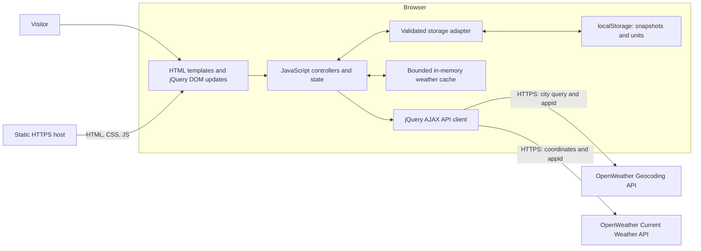
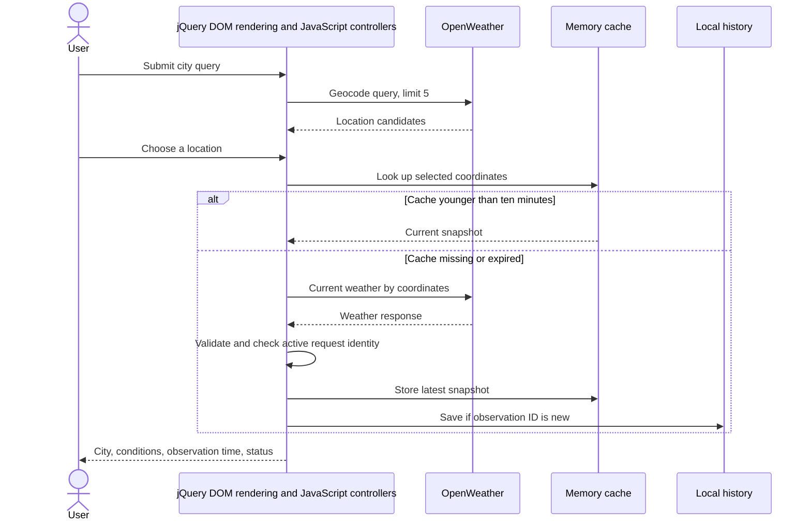

# Weather App Architecture

Status: Planned architecture for WX-001. No application source has been created yet.

## System boundaries

The app is a static single-page frontend. OpenWeather is the only external data service. All application state and saved history live in the visitor's browser. No application backend, proxy, authentication service, or remote database is part of this design.



The static host serves HTML, CSS, JavaScript, and local vendor assets directly. The browser calls OpenWeather directly, including during development. No compilation, API proxy, or serverless relay is introduced.

There is no application backend, database service, or user authentication.

History means observations saved after successful weather lookups on this browser.

## Key decisions

| Decision | Reason and consequence |
| --- | --- |
| HTML5 + CSS3 + JavaScript + jQuery | Semantic page structure, responsive plain styles, and small browser modules; no application build step |
| CSS Grid/Flexbox + CSS variables | Responsive layouts and reusable design tokens using ordinary stylesheets |
| Plain state objects and controllers | Keep selected city, request state, cache, and rendering coordinated without a state library |
| jQuery DOM/events/AJAX | Use the full local jQuery build; [AJAX](https://api.jquery.com/jQuery.ajax/) supports JSON requests and cancellation; use [`.text()`](https://api.jquery.com/text/) for dynamic text |
| Explicit search submission | Avoid requests on each keystroke and simplify accessible result selection |
| Geocode before weather | Disambiguate city names, then request conditions by coordinates |
| Metric normalization | Cache and History share a stable representation; unit changes require no request |
| Local saved observations | Meets the History feature within the general free API offering |
| Ten-minute cache | Reduce repeated requests in line with [OpenWeather guidance](https://openweathermap.org/appid) |
| No router | Search, conditions, and History share one screen; no static-host route rewrite is needed |

OpenWeather lists Current Weather and Geocoding in its [general free plan](https://openweathermap.org/price). Historical archive endpoints and metered One Call products are excluded from this plan. Recheck plan access and terms before releasing; student-only offerings are not assumed.

## Planned source layout

The following files and directories are implementation targets, not existing code:

```text
index.html                     semantic markup and reusable HTML templates
assets/
  css/
    tokens.css
    styles.css
  js/
    config.example.js          placeholder-only browser configuration
    config.js                  maintainer's local configuration; ignored by Git
    app.js                     entry module and one-time event setup
    state.js                   plain application state
    controllers/
      city-search.js           search request lifecycle
      weather.js               selection, cache, and cancellation
      history.js               saved-view and deletion actions
    services/
      openweather.js           jQuery AJAX, normalization, and errors
    storage/
      weather-storage.js       versioned persistence and safe fallback
    ui/
      render.js                template cloning and safe jQuery DOM updates
      dialogs.js               clear-history dialog and focus management
    utils/
      units.js
      time.js
      validators.js            runtime response and stored-record validation
  vendor/
    jquery.min.js              pinned full build including AJAX
    LICENSE.jquery.txt
tests/
  unit/
    index.html                 QUnit browser harness
    fixtures.js
    weather.test.js
  qunit.spec.js                Playwright adapter for the QUnit harness
  e2e/
    weather.spec.js
  vendor/                      pinned QUnit browser assets and license
package.json                   development/test tools and scripts only
package-lock.json
eslint.config.js
playwright.config.js
```

Load local jQuery and the optional browser config script before the `app.js` module. Initialize once when the DOM is ready, bind static handlers once, and use delegated jQuery handlers for dynamic result and History rows. Clone native `<template>` elements and populate values with `.text()` or `textContent`; never interpolate query/provider text into HTML strings. Document object shapes with JSDoc and validate them at runtime.

Pin full jQuery and QUnit distributions with their licenses during implementation. Node.js/npm are used only for the static development server, lint, and browser automation. Avoid creating empty abstraction layers in advance.

## API contract

Only these API routes are allowed. Pass query parameters through the `data` option of `$.ajax()` for encoding and use HTTPS. Set `dataType: 'json'`, `jsonp: false`, and `timeout: 10000`; use ordinary cross-origin JSON requests. Placeholders below are explanatory, never working credentials.

| Operation | Request | Response use |
| --- | --- | --- |
| Search | `GET https://api.openweathermap.org/geo/1.0/direct?q={query}&limit=5&appid={key}` | Validate an array of location candidates; show name, optional state, country, and coordinates when needed to distinguish labels |
| Current conditions | `GET https://api.openweathermap.org/data/2.5/weather?lat={lat}&lon={lon}&units=metric&lang=en&appid={key}` | Normalize temperature, feels-like, humidity, wind, conditions, `dt`, and `timezone` |

Contracts: [Geocoding API](https://openweathermap.org/api/geocoding-api), [Current Weather API](https://openweathermap.org/api/current). Do not use deprecated built-in city-name weather lookups.

API key configuration is `window.WEATHER_CONFIG.openWeatherApiKey`, read safely when the config object or property is missing. A maintainer copies `assets/js/config.example.js` to ignored `assets/js/config.js`, sets the key, and serves that script before the application entry module. Reject missing or placeholder configuration before attempting a request. Show a setup-unavailable message while leaving saved History readable. Visitors have no login or API-key entry flow.

The config script and requests expose this key to the browser. Ignoring `assets/js/config.js` prevents accidental source commits, but cannot conceal a browser-delivered key. Deploy the configured file alongside the static assets and keep only the placeholder example in Git. Redact `appid` from diagnostics and never persist request URLs. Browser caching cannot enforce OpenWeather's shared account-level quota.

## Data contracts

Plain JavaScript object contracts, documented with JSDoc. These comments describe the data; external values still require runtime validation.

```js
/**
 * @typedef {Object} City
 * @property {string} id Selected lat/lon rounded to 4 decimals for identity only.
 * @property {string} name
 * @property {string} [state]
 * @property {string} country
 * @property {number} lat Original geocoding coordinate used for requests.
 * @property {number} lon Original geocoding coordinate used for requests.
 */

/**
 * @typedef {Object} WeatherSnapshot
 * @property {string} id city.id + ':' + observedAt.
 * @property {City} city
 * @property {number} observedAt API dt converted to UTC milliseconds.
 * @property {number} fetchedAt Browser receipt time in UTC milliseconds.
 * @property {number} timezoneOffsetSeconds API offset for this observation.
 * @property {number} temperatureC
 * @property {?number} feelsLikeC
 * @property {?number} humidityPct
 * @property {?number} windMps
 * @property {?number} conditionCode
 * @property {string} description Fallback: 'Conditions unavailable'.
 */

/**
 * @typedef {Object} HistoryEnvelope
 * @property {number} version Must equal 1.
 * @property {WeatherSnapshot[]} snapshots Newest first; maximum 20.
 */
```

Retain the selected geocoding label even if the weather response names a nearby station. Validate finite coordinates in range, temperature, observation timestamp, and UTC offset as core data. Validate optional readings and use `null` for absent/invalid optional values. Use local icons derived from condition codes, with a neutral fallback.

Store values without display rounding. Format Celsius/Fahrenheit and m/s/mph at render time. Use `F = C × 9/5 + 32` and `mph = m/s × 2.236936`. Format the observation at `observedAt + timezoneOffsetSeconds × 1000` using a UTC formatter, and label the result with its `UTC±hh:mm` offset. Do not apply the visitor's timezone again or guess an IANA timezone from city names.

## Request and state flow



- Search state: `idle → loading → results | empty | error`. Validate trimmed input before calling the API. Each candidate is an explicit selection, including a single result.
- Weather state: `idle → loading → success | error`. Track the selected city separately from the displayed snapshot. Opening saved data has a distinct `saved` display mode and makes no request.
- Use a new request ID for each search and weather operation. Abort obsolete work on a newer intent, saved-snapshot selection, city change, or controller teardown. A result may update the UI, cache, or History only if its ID and selected city still match the active intent.
- If changing cities, clear the old card or replace it with a same-city saved preview. Never relabel an old city's readings as the newly selected city.
- Keep the active jqXHR returned by `$.ajax()` and cancel it with `.abort()`. Handle `.done()`, `.fail()`, and `.always()` with request-ID guards. Treat intentional `abort` as silent and `timeout` as a recoverable error; an obsolete completion must not clear a newer request's loading state.
- No polling, speculative requests, automatic retries, or weather requests for unselected candidates.

## Cache and persistence

| Store | Key and lifetime | Rules |
| --- | --- | --- |
| Weather cache | In-memory map by city ID; maximum 20 cities | Fresh when `0 <= now - fetchedAt < 600000ms`; evict least recently used city at capacity |
| History | `weather-app:history:v1` in localStorage | Version 1 envelope; up to 20 unique observation IDs; newest saved observations first |
| Units | `weather-app:preferences:v1` in localStorage | Version 1 object with `units: 'metric'` or `'imperial'`; metric default |

On load, validate persisted records and seed the cache with the newest valid snapshot per city. Unknown envelope versions or malformed JSON reset only the affected app key and show a brief notice. Discard invalid records safely. If storage reads/writes fail, use session memory and show “History will only be kept for this session.” Never call `localStorage.clear()`.

Every valid, still-active weather network response is eligible for saving. If the city/observation ID already exists, retain the existing saved record without adding or reordering a row; the memory cache may update its receipt time. Otherwise prepend the snapshot and drop the oldest beyond 20. Failed, cancelled, cached, and saved-only views create no records.

Refresh and “View current” first check the ten-minute cache. If fresh, reuse it with a short “Using recent weather” status. If expired, request current data. Opening “View saved” always preserves the original reading and timestamp, even if newer data is cached.

Deleting one History row removes that saved observation and evicts a matching cached observation. Confirmed Clear history removes the app's history key and all in-memory weather cache; keep the unit preference. An on-screen observation can remain in the plain JavaScript application state, marked unsaved, without being persisted again until a later explicit successful network lookup.

Removal also aborts and invalidates pending weather requests for that city; Clear history aborts and invalidates all pending weather requests. A response started before deletion must not repopulate deleted cache or History. A later explicit lookup may save the observation again.

## Failures and recovery

| Condition | Behavior |
| --- | --- |
| Empty geocoding array | “No cities found. Try adding a country code.” No weather request |
| Missing configuration | Show maintainer setup message; search/live controls unavailable; saved data readable |
| 401/403 | Explain provider key/access problem; no retry loop or visitor login prompt |
| 429 | Show rate-limit message; block new live requests until `Retry-After` when readable, otherwise ten minutes; retry remains manual |
| Network error, timeout, 5xx | Show manual Retry; keep any same-city saved observation visibly saved/stale |
| Invalid JSON or missing core fields | Reject payload, show unavailable-data message, do not add History |
| Missing optional readings | Display em dash or neutral icon without failing valid temperature data |
| Storage error | Continue weather use and session History; explain persistence limitation |

When a snapshot's cache age reaches ten minutes, label it stale on display and do not fetch until an explicit action. Saved mode is always labelled saved. Use provider observation time as the weather timestamp, never the request receipt time.

## Static delivery and validation

Serve `index.html` and `assets/` directly over HTTPS; there is no application build or compilation step. Keep development tools, tests, and repository metadata out of the deployed files. Use a supported Node.js LTS release for development/test commands and document compatible versions and install steps. Configure the ignored browser `config.js` from the placeholder `config.example.js` before live use. Use a local HTTP static server for development so ES modules load consistently.

Use [QUnit](https://qunitjs.com/intro/) in a browser harness for utility, controller, and DOM tests, stubbing the AJAX boundary with controlled jqXHR-compatible responses. `npm test` runs the harness through a Playwright unit project; `npm run test:e2e` runs a separate E2E project with network interception. Configure both against the static development server and surface QUnit failures as a nonzero test exit.

Verify the exact delivery files on a static host, including direct cross-origin API calls with a maintainer key when available. Live checks are manual and excluded from automated tests. See [AGENTS.md](../AGENTS.md#6-testing-expectations) and the [backlog](BACKLOG.md) for completion gates.
